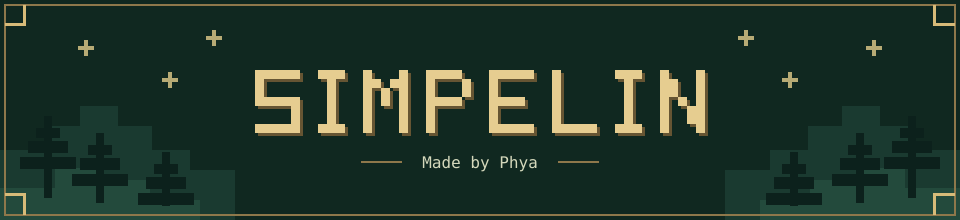

Catatan belajar bernuansa **pixel fantasy**. Tulis, rapikan, dan pahami materi sambil menikmati animasi sihir.

## ✨ Fitur

- **Catatan rapi:** kategori, gambar, tabel, dan blok kode.
- **Suasana fantasy:** efek sihir, Motion Lab, dan Ooalah witch.
- **Bantuan AI:** penjelasan sederhana, contoh, dan materi pelengkap.
- **Simpan otomatis** di browser, tanpa login. Bisa ekspor cadangan ZIP.

## 🚀 Mulai — Windows & Linux

1. Pasang [Node.js LTS](https://nodejs.org/en/download) (minimal versi 22.13).
2. Unduh ZIP proyek ini, lalu ekstrak.
3. Buka terminal di folder yang berisi `package.json`:  
   **Windows:** ketik `cmd` di bilah alamat folder, lalu Enter.  
   **Linux:** klik kanan folder → **Open in Terminal**.
4. Jalankan satu per satu (perlu internet):

```sh
npm ci
npm run build
npm start
```

Buka **http://localhost:3000**. Biarkan terminal terbuka. Untuk berhenti, tekan **Ctrl+C**. Berikutnya cukup `npm start`.

## 🪄 Pakai AI

Buka **Pengaturan → AI Provider**, pilih OpenAI, Gemini, atau Anthropic. Masukkan ID model dan API key milikmu, lalu **Uji koneksi → Aktifkan pengaturan**.

Mencatat tetap bisa tanpa AI. Penggunaan AI mengikuti tarif provider; periksa kembali materi tambahannya.

## 💾 Simpan cadangan

Catatan tersimpan di browser yang kamu gunakan. Sebelum menghapus data browser atau pindah perangkat, pilih **Pengaturan → Data lokal → Ekspor cadangan**.

---

Untuk pengembang: `npm run dev` · [Dokumentasi teknis](docs/IMPLEMENTATION.md)
